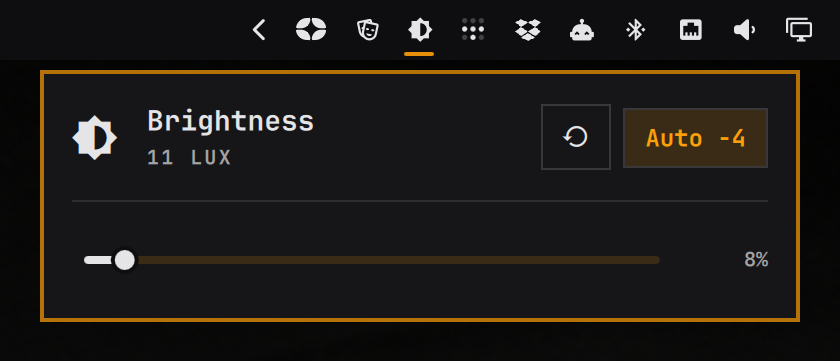

# Brightness

[](https://github.com/joaodrp/omarchy-auto-brightness/actions/workflows/ci.yml)
[](LICENSE)

Auto brightness for Omarchy, for your screens and your keyboard. Every
screen follows the light in the room, the way it does on a Mac or a phone,
and learns how bright you like it. The keyboard lights up when the room
gets dark.


## Highlights

- 🌗 Every screen follows the room: the Apple Studio Display, a laptop
  screen and most external monitors, all at once, each on its own.
- 🎚️ It learns from you. Nudge a screen brighter or dimmer, by slider,
  wheel or hotkey, and it remembers; the chip shows how much, `Auto +24`.
- ⌨️ Keyboard backlight, if you want it: on in the dark, off in daylight.
  Turn it off for the night and it stays off until you lock.
- 🫥 Smooth and quiet: changes fade in rather than jump, and small
  flickers in the light are ignored.
- 🖥️ Each bar controls the screen it sits on. The widget shows only where
  there is something to control.
- 🎨 Built from the shell's own components. Follows your theme.

## Install

```sh
omarchy plugin add https://github.com/joaodrp/omarchy-auto-brightness.git --enable
```

For the keyboard backlight, turn on **Adjust the keyboard backlight** in
Setup > Plugins.

## What it shows

Click the bar icon for the pop-up. On the laptop's bar it has two
sections, one for the screen and one for the keyboard, as above. On any
other screen's bar, or with the keyboard off, it has just the screen:



| Control | Does |
| --- | --- |
| Slider | Sets the brightness. On a screen with Auto on, it also teaches Auto how bright you like that screen. On the keyboard, it holds the level for now |
| `Auto` / `Manual` chip | Follow the room, or stay where you put it |
| Restore button | Forget what Auto learned, or what you set on the keyboard, and follow the room again |

Scroll on the bar icon to change the screen's brightness without opening
the pop-up. Brightness hotkeys work as before, and the sliders follow them.

### Screens

Each screen uses a light sensor, in this order: its own, as the Studio
Display has; else the laptop's, while the lid is open; else any other. A screen with no sensor at all gets the slider only.

A borrowed sensor reads the light where it sits, so it suits a monitor in
the same room. What you teach a screen absorbs a steady difference.

### Keyboard

- Lit in a dark room, off in a lit one, from the laptop's sensor.
- A level you choose, by slider or hotkey, stays until you lock, close the
  lid, sleep or every screen goes dark, whatever the light does.
- While you are locked the keys stay off. On Auto, they also stay off
  while the lid is closed.

## Settings

Set through Setup > Plugins, or inline on the plugin's entry in
`~/.config/omarchy/shell.json`:

| Key | Default | Meaning |
| --- | --- | --- |
| `screens` | `true` | Adjust screen brightness. Off, the plugin leaves every screen alone. |
| `auto` | `true` | Follow the room on a screen seen for the first time. Each screen then keeps its own choice. |
| `keyboard` | `false` | Adjust the keyboard backlight. |

What each screen has learned, and whether it is on Auto, is saved under
`displays` in the same entry. The pop-up sets it; there is no need to
edit it by hand.

## Requirements

- Omarchy 4.0 or newer.
- For Auto, a light sensor Linux can read: the Studio Display's or a
  laptop's. Without one you get the slider only.
- Any of these screens:
  - An Apple Studio Display, with its USB cable connected.
  - A laptop screen whose backlight Linux can control.
  - An external monitor that supports DDC/CI.
- For the keyboard, a laptop with a backlit keyboard.

Everything else ships with Omarchy.

## Good to know

- Auto changes monitors over DDC/CI in steps, at most every 5 s, without
  a fade.
  One that does not answer shows "Cannot reach the display".
- Two Apple displays at once are not supported.
- Brightness only: the Studio Display offers no colour temperature
  control over USB.
- Brightness hotkeys show in the pop-up at once while it is open, except
  on monitors over DDC/CI. Otherwise Auto notices them within 10 s, or
  30 s over DDC/CI.
- The keyboard needs Omarchy's own lock screen. It can take up to 2 s to
  notice a lock.
- The keyboard stays lit in the dark while you are not typing.
- Run one keyboard controller only: some Omarchy forks ship their own.
- Some laptop light sensors stop working after a sleep;
  [the fix](docs/how-it-works.md#a-sensor-that-reads-0-after-sleep).

## Scripting

```sh
omarchy-shell auto-brightness status            # every screen and the keyboard
omarchy-shell auto-brightness toggleFor eDP-1   # Auto on or off
omarchy-shell auto-brightness forgetFor eDP-1   # forget what it learned
omarchy-shell auto-brightness setFor eDP-1 40   # as if you moved the slider
```

Name a screen by its output, as `hyprctl monitors` lists it, or use
`keyboard`. `toggle`, `enable`, `disable`, `forget` and `set 40` act on the main
screen: the Studio Display if on, else the laptop's, else the first
external monitor.

## Contributing

Bug reports and pull requests welcome. See [CONTRIBUTING.md](CONTRIBUTING.md)
to get set up, [docs/how-it-works.md](docs/how-it-works.md) for how the
pieces fit, and [docs/design.md](docs/design.md) for why.

## Remove

```sh
omarchy plugin remove io.github.joaodrp.auto-brightness
```

## License

MIT, see [LICENSE](LICENSE).
