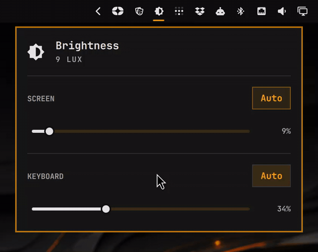

# Brightness

[](https://github.com/joaodrp/omarchy-auto-brightness/actions/workflows/ci.yml)
[](LICENSE)

Auto brightness for Omarchy: a bar widget that reads an ambient light
sensor and follows the room. Drives the Apple Studio Display when it is
connected, else the laptop's internal panel; see
[Other displays](#other-displays).



- Appears in the bar only while a supported display is connected.
- Auto follows the room the way macOS and Android do: smoothed lux,
  hysteresis and debounce, a log-shaped curve, a quick brighten and a slow
  dim.
- Auto learns. Any manual change, slider, wheel or hotkey, becomes your
  offset from the curve, shown on the chip as `Auto +8` and kept until you
  press the restore button beside it.

## Requirements

One of:

- An Apple Studio Display with its USB side connected, so Hyprland reports
  make `Apple Computer Inc` and the light sensor appears under
  `/sys/bus/iio`. Needs `asdcontrol` and its passwordless sudo rule, which
  Omarchy installs. The Pro Display XDR should work but is untested.
- A laptop with an ambient light sensor under `/sys/bus/iio` and a
  backlight `brightnessctl` can drive.

With both, the Studio Display wins; the panel takes over when it is
unplugged, within 10 s.

## Install

```sh
omarchy plugin add https://github.com/joaodrp/omarchy-auto-brightness.git --enable
```

## Settings

Inline on the plugin's entry in `~/.config/omarchy/shell.json`, or via
Setup > Plugins:

| Key | Default | Meaning |
| --- | --- | --- |
| `auto` | `true` | Follow the room. The chip toggles it. |
| `offset` | `0` | Your correction to the curve, in brightness points. Manual changes rewrite it; restore clears it. |

IPC:

```sh
omarchy-shell auto-brightness status
omarchy-shell auto-brightness toggle   # also enable / disable
omarchy-shell auto-brightness forget   # clear the offset
omarchy-shell auto-brightness set 40   # as if you moved the slider
```

## How it works

Every half second the controller reads the display's light sensor and:

| Stage | |
| --- | --- |
| Smooth | Exponential average, settles in about 2 s. |
| Accept | Only a change of +10% or -20%, held for 4 s or 8 s. |
| Map | Lux to brightness, log-shaped: 5% in the dark, 24% at 100 lux, 100% at 5000. Plus `offset`. |
| Ramp | 20 points per second up, 13 down, capped at 2 s and 3 s, written one step per display write. The step is what the rate covers in one write's time, so the fade is as fine as the display allows. |

The evidence for each stage is in [docs/design.md](docs/design.md). The
loop structure started from
[miharekar/omarchy-studio-display-auto-brightness](https://github.com/miharekar/omarchy-studio-display-auto-brightness).

## Other displays

One display is driven at a time. Each kind is a profile in `controller`,
tried in priority order, with its own detection, sensor and write path:

| What | Studio Display | Laptop panel |
|------|----------------|--------------|
| Detection | The Apple test `omarchy-brightness-display` routes on | An enabled `eDP`, `LVDS` or `DSI` output; a closed lid disables it |
| Writes | `omarchy-brightness-display-apple`, sidestepping the routing helper's lock | `brightnessctl` on `omarchy-hw-display`'s backlight |
| Sensor | IIO `als` device under the Apple USB path | Any other IIO illuminance device |
| Lux unit | Fixed 0.001: millilux, though the kernel scale reads 1.0 | The kernel's `in_illuminance_scale` and `in_illuminance_offset` |

Still missing: external monitors other than Apple's (DDC has no light
sensor to pair with), and driving more than one display at once.

Both displays share one curve and one offset. The curve is anchored in
nits on the Studio Display, so a panel with another peak lands off it by
a roughly constant amount, which the offset absorbs; a panel lived with
for long could earn its own anchors without a new structure. Hysteresis,
debounce, ramp and learning carry over unchanged; the ramp measures the
display's write latency and steps as finely as that allows.

Got another display with a light sensor? Add a profile: the comment above
`profiles` in `controller` lists the functions one defines. Or open an
issue with what it exposes under `/sys/bus/iio` and in
`hyprctl monitors -j`.

Omarchy has open pull requests for built-in auto brightness. If one lands,
this plugin will shrink to whatever the built-in version does not cover.

## Known limits

- Hotkey changes are noticed within 10 s. On the Studio Display each check
  is a `sudo asdcontrol` call, which the journal logs.
- Brightness only. The Studio Display has no colour temperature control
  over USB.
